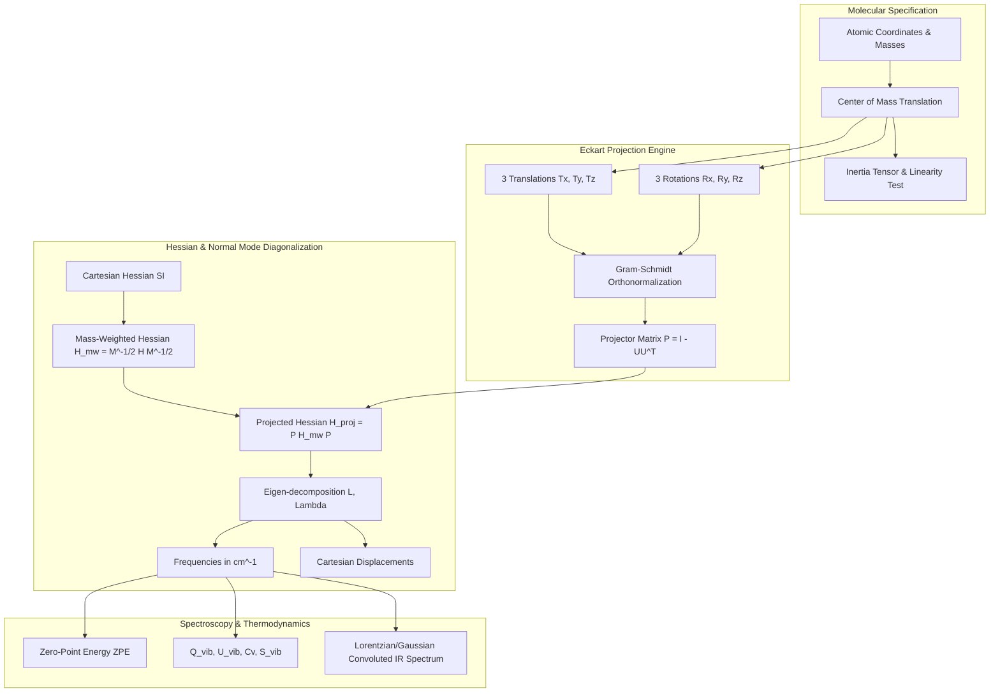

# QuantumSpectra

[](https://github.com/ZengLLQ/quantum-spectra/actions)
[](https://opensource.org/licenses/MIT)
[](https://julialang.org/)
[](https://en.wikipedia.org/wiki/Infrared_spectroscopy)

**QuantumSpectra** is a computational quantum chemistry and molecular vibrational normal mode analysis library written in Julia. It diagonalizes mass-weighted Hessian tensors, projects out infinitesimal translations and rotations via Eckart-Sayvetz conditions, computes harmonic vibrational frequencies in $\text{cm}^{-1}$, evaluates zero-point vibrational energy (ZPE) and statistical thermodynamic functions ($Q_{\text{vib}}, U_{\text{vib}}, C_{v,\text{vib}}, S_{\text{vib}}$), and generates synthetic infrared (IR) absorption spectra.

---

## Theoretical Foundations

### 1. Mass-Weighted Hessian Transformation

For an $N$-atom molecule with Cartesian force constant matrix (Hessian) $H_{ij} = \frac{\partial^2 V}{\partial x_i \partial x_j}$, the mass-weighted Hessian $H_{\text{MW}}$ is defined by scaling by atomic masses $m_i$:

$$
H_{\text{MW}, ij} = \frac{H_{ij}}{\sqrt{m_i m_j}}
$$

Where the mass matrix $M = \operatorname{diag}(m_1, m_1, m_1, \dots, m_N, m_N, m_N)$.

### 2. Eckart Translational & Rotational Projection

To isolate the $3N - 6$ (or $3N - 5$ for linear molecules) internal vibrational degrees of freedom from zero-frequency external motions, an orthonormal basis $U \in \mathbb{R}^{3N \times 6}$ is constructed from center-of-mass translations and infinitesimal rigid rotations:

$$
\mathbf{T}_\alpha = \sqrt{m_i} \hat{\mathbf{e}}_\alpha, \quad \mathbf{R}_\alpha = \sqrt{m_i} (\hat{\mathbf{e}}_\alpha \times \mathbf{r}_i)
$$

The idempotent Eckart projection operator $P$ satisfies:

$$
P = I_{3N} - \sum_{k=1}^{6} \mathbf{u}_k \mathbf{u}_k^T, \quad P^2 = P, \quad P^T = P
$$

Projecting the mass-weighted Hessian:

$$
H_{\text{proj}} = P H_{\text{MW}} P
$$

### 3. Harmonic Normal Mode Frequencies

Eigen-decomposition of the projected mass-weighted Hessian yields eigenvalues $\lambda_k$ (in $\text{s}^{-2}$):

$$
H_{\text{proj}} \mathbf{L}_k = \lambda_k \mathbf{L}_k
$$

The vibrational wavenumber $\tilde{\nu}_k$ in $\text{cm}^{-1}$ is:

$$
\tilde{\nu}_k = \frac{1}{2\pi c} \sqrt{\lambda_k}
$$

### 4. Zero-Point Energy & Vibrational Thermodynamics

Zero-Point Vibrational Energy (ZPE):

$$
\text{ZPE} = \frac{1}{2} \sum_{k=1}^{3N-6} h \nu_k = \frac{1}{2} h c \sum_{k=1}^{3N-6} \tilde{\nu}_k
$$

Vibrational partition function $Q_{\text{vib}}(T)$ at temperature $T$:

$$
Q_{\text{vib}}(T) = \prod_{k=1}^{3N-6} \frac{1}{1 - e^{-\Theta_{v, k} / T}}, \quad \Theta_{v, k} = \frac{h \nu_k}{k_B}
$$

Internal energy $U_{\text{vib}}$ and constant-volume heat capacity $C_{v, \text{vib}}$:

$$
U_{\text{vib}}(T) = N_A \sum_{k=1}^{3N-6} h \nu_k \left( \frac{1}{2} + \frac{1}{e^{\Theta_{v, k} / T} - 1} \right)
$$

$$
C_{v, \text{vib}}(T) = R \sum_{k=1}^{3N-6} \left(\frac{\Theta_{v, k}}{T}\right)^2 \frac{e^{\Theta_{v, k} / T}}{(e^{\Theta_{v, k} / T} - 1)^2}
$$

---

## Architectural Flow



---

## Module Layout

```
src/
├── QuantumSpectra.jl   # Main module re-exports
├── constants.jl        # Physical constants (h, c, N_A, k_B, amu to kg)
├── molecule.jl         # Atom and Molecule types, COM, moment of inertia
├── projection.jl       # Eckart translational and rotational projection operator
├── normal_modes.jl     # Mass-weighted Hessian transformation and diagonalization
├── thermodynamics.jl   # ZPE, partition function, enthalpy, entropy, heat capacity
└── spectrum.jl         # Lorentzian and Gaussian line-broadened IR spectrum synthesis
test/
└── runtests.jl         # Verification against analytical diatomic oscillator and water
```

---

## Getting Started

```julia
using Pkg
Pkg.activate(".")
Pkg.instantiate()

using QuantumSpectra

# Define Water Molecule (H2O)
h2o = Molecule([
    Atom("O", 15.9994, [0.0, 0.0, 0.0]),
    Atom("H", 1.00784, [0.0, 0.757, 0.586]),
    Atom("H", 1.00784, [0.0, -0.757, 0.586]),
])

# Compute normal modes and thermodynamics
# analysis = calculate_normal_modes(h2o, H_cart)
# thermo = calculate_vibrational_thermodynamics(analysis, 298.15)
```

Run test suite:

```bash
julia --project=. test/runtests.jl
```

---

## License

This project is licensed under the [MIT License](LICENSE).
